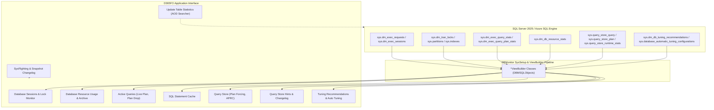

# DBMonitor: Database Performance & Telemetry Monitor for D365FO

**DBMonitor** is an enterprise-grade database monitoring, diagnostics, and performance optimization suite built natively for **Microsoft Dynamics 365 for Finance and Operations (D365FO)**. It provides real-time visibility into SQL Server and Azure SQL Database internals directly from the D365FO client interface, bridging the gap between X++ application execution and SQL Server engine internals.

A substantial portion of DBMonitor functions as a specialized, high-performance wrapper around **SQL Server Dynamic Management Views (DMVs)**, Dynamic Management Functions (DMFs), Query Store catalog views, and Automatic Tuning engines. The implementation is verified and aligned with **Microsoft SQL Server 2025** and **Azure SQL Database** / **Microsoft Fabric SQL Database**.

---

## Table of Contents

1. [Architecture & DMV Integration](#architecture--dmv-integration)
2. [Prerequisites & Deployment](#prerequisites--deployment)
3. [Features & Capabilities](#features--capabilities)
   - [1. Database Sessions & Lock Monitor](#1-database-sessions--lock-monitor)
   - [2. Database Resource Usage Monitor (Azure SQL & Fabric SQL)](#2-database-resource-usage-monitor-azure-sql--fabric-sql)
   - [3. Active Queries Telemetry](#3-active-queries-telemetry)
   - [4. SQL Statement Cache Analysis](#4-sql-statement-cache-analysis)
   - [5. Query Store Suite & Plan Management](#5-query-store-suite--plan-management)
   - [6. Query Store Query Hints & Change Tracking](#6-query-store-query-hints--change-tracking)
   - [7. Automatic Tuning Recommendations & Configuration](#7-automatic-tuning-recommendations--configuration)
   - [8. SysFlighting Tracking & Change History](#8-sysflighting-tracking--change-history)
   - [9. Deep Table Statistics Update Utility](#9-deep-table-statistics-update-utility)
   - [10. Data Entities for DMF & OData Export](#10-data-entities-for-dmf--odata-export)
   - [11. Security Roles, Duties, and Privileges](#11-security-roles-duties-and-privileges)
4. [SQL Server 2025 & Azure SQL DMV Reference Guide](#sql-server-2025--azure-sql-dmv-reference-guide)

---

## Architecture & DMV Integration

In standard D365FO development, the Application Object Tree (AOT) metadata designer cannot directly create views targeting SQL Server Dynamic Management Views (`sys.dm_*`) or Query Store catalog views (`sys.query_store_*`) because they reside in the system schema rather than application tables.

DBMonitor overcomes this limitation using an automated deployment pattern:
- **AOT Views (`AxView`)**: Standard views are declared in the AOT defining the schema, field types, and labels so that forms, queries, and security privileges can consume them natively.
- **SysSetup Framework (`SysSetup` / `SysSetupAsync`)**: Each view is paired with an internal setup class decorated with `[SysSetupTable(tableStr(...))]` and `[SysSetupConfig(false, 300, 0.0)]` (e.g., `DBMSQLMonActiveQueriesViewSetup`, `DBMSQLSessionInfoViewSetup`, `DBMSQLQueryStore*ViewSetup`).
- **View Builders (`DBMSQLObjects`)**: During database synchronization (`db sync`), the setup classes trigger specialized View Builder classes (e.g., `DBMSQLMonActiveQueriesViewBuilder`, `DBMSQLSessionInfoViewBuilder`). The builders execute direct DDL (`CREATE OR ALTER VIEW`) on the SQL engine, replacing the empty view definitions with direct, optimized SELECT queries against SQL Server 2025 DMVs and system catalog views while preserving column aliases mapped to the D365FO view fields.

This approach gives administrators and developers real-time, interactive access to low-level SQL Server diagnostics directly inside D365FO forms with zero external tooling or SSMS required.

---

## Prerequisites & Deployment

### SQL Server Version Requirements
- **Tier 2+ Sandbox and Production (Azure SQL Database / SQL 2025)**: Supported out-of-the-box. All DMVs, Query Store views, and resource usage statistics (`sys.dm_db_resource_stats`) are available natively.
- **Tier 1 / Cloud-Hosted Environments (CHE) / Local Development VMs**:
  - Recommended SQL Server version: **Microsoft SQL Server 2025 Developer or Enterprise Edition**.
  - If upgrading a Tier 1 development VM to SQL Server 2025:
    1. Run the MS SQL 2025 Developer Edition installer in **Upgrade** mode, retaining default settings.
    2. *DIXF / SSIS Compatibility*: The SQL 2025 installer keeps SSIS 15.0 running but may affect shared assemblies used by DIXF. If DIXF fails, launch the **MS SQL 2019** installer in **Repair** mode. Once the repair completes, reboot the VM. DIXF and SQL 2025 will function in harmony.

### Database Synchronization ("Full Monty" Sync)
Because the custom SQL view definitions are injected through the `SysSetup` / `SysSetupAsync` pipeline, a standard incremental sync from Visual Studio may skip setup classes. When deploying to a Tier 1 environment or after model changes, run a full database synchronization from the command line:

```cmd
X:\AosService\PackagesLocalDirectory\bin\Microsoft.Dynamics.AX.Deployment.Setup.exe ^
  -bindir "X:\AosService\PackagesLocalDirectory" ^
  -metadatadir "X:\AosService\PackagesLocalDirectory" ^
  -sqluser axdbadmin ^
  -sqlserver localhost ^
  -sqldatabase axdb ^
  -setupmode sync ^
  -syncmode fullall ^
  -isazuresql false ^
  -sqlpwd <axdbadmin_password>
```

---

## Features & Capabilities



---

### 1. Database Sessions & Lock Monitor

#### Real-Time Database Sessions
- **Menu Path**: *System administration > Inquiries > DBMonitor > Database sessions* (`DBMDBSessionInfo`)
- **Underlying DMVs**: [`sys.dm_exec_sessions`](https://learn.microsoft.com/en-us/sql/relational-databases/system-dynamic-management-views/sys-dm-exec-sessions-transact-sql), [`sys.dm_exec_requests`](https://learn.microsoft.com/en-us/sql/relational-databases/system-dynamic-management-views/sys-dm-exec-requests-transact-sql), [`sys.dm_exec_cursors(0)`](https://learn.microsoft.com/en-us/sql/relational-databases/system-dynamic-management-views/sys-dm-exec-cursors-transact-sql), [`sys.dm_exec_connections`](https://learn.microsoft.com/en-us/sql/relational-databases/system-dynamic-management-views/sys-dm-exec-connections-transact-sql), [`sys.dm_tran_locks`](https://learn.microsoft.com/en-us/sql/relational-databases/system-dynamic-management-views/sys-dm-tran-locks-transact-sql), [`sys.partitions`](https://learn.microsoft.com/en-us/sql/relational-databases/system-catalog-views/sys-partitions-transact-sql), [`sys.indexes`](https://learn.microsoft.com/en-us/sql/relational-databases/system-catalog-views/sys-indexes-transact-sql).
- **Hierarchical Blocking Tree**: Utilizes a recursive Common Table Expression (CTE) to calculate `rootSPID`, hierarchical `nestingLevel`, and indentation/sorting paths up to 29 levels deep.
- **SQL Text Identification**:
  - `currentSQL`: Query currently executing via `sys.dm_exec_sql_text(request.sql_handle)`.
  - `cursorSQL`: Query executed by the last open cursor via `sys.dm_exec_cursors(0)`.
  - `recentSQL`: Most recent query executed on the connection via `sys.dm_exec_connections.most_recent_sql_handle`.
- **D365FO Session & Batch Heuristics**:
  - D365FO connection pooling reuses database sessions. When a transaction begins, the AOS writes user and session identifiers into the SQL session context. DBMonitor parses `context_info` using SQL Server JSON extraction functions (`isJSON`, `JSON_VALUE`) to resolve the **D365FO User ID** (`axUserId`) and **Session ID** (`axSessionId`).
  - Automatically joins the executing session with the `Batch`, `BatchJob`, and `ClassIdTable` tables (`STATUS = 2` / Executing) to display the **Batch Job ID**, **Batch Caption**, and **Batch Class Name** responsible for locks or active work.
- **Lock Detail Resolution**: Identifies lock resource type (`OBJECT`, `KEY`, `PAGE`, `RID`), lock mode (`X`, `IX`, `U`, `S`), locked Table name, and Index name for sessions in `WAIT` status.

#### Automated Lock Monitor Batch
- **Menu Path**: *System administration > Periodic > DBMonitor > DBM Lock monitor* (`DBMLockMonitorBatch`)
- **Configuration**: *System administration > Setup > System job parameters* (tab *Lock monitor*):
  - `Activate lock monitor` (`DBMActivateLockMonitor`): Enables or disables background polling.
  - `Monitoring frequency` (`DBMLockMonMonitorFreq`): Idle polling frequency in seconds (default: 15s).
  - `Lock re-scan frequency` (`DBMLockMonReScanFreq`): Polling frequency while blocking chains are active (default: 5s).
- **Generations Engine**: When blocking occurs, the batch switches to rapid re-scanning mode and increments lock tree generations. To eliminate noise from transient row locks, only locks surviving more than one re-scan generation before resolution are captured.
- **Lock History Snapshot**: Dumps the blocking chain, user context, queries, and locked objects into `DBMDbLockHistory`.
- **Locking History Inquiry**: *System administration > Inquiries > DBMonitor > Locking history* (`DBMDBLockHistory`). Includes calculated duration computed via computed column view `DBMDbLockHistoryCalc`.
- **History Cleanup**: *System administration > Periodic > DBMonitor > Clean up DB locking history* (`DBMDBLockHistoryCleanup`) allows scheduled or manual purging of historical records older than a configured number of days.

> [!WARNING]
> Do not set monitoring or re-scan frequencies below 15 and 5 seconds respectively. Polling SQL lock structures too aggressively consumes server resources and can degrade database performance.

---

### 2. Database Resource Usage Monitor (Azure SQL)

- **Menu Paths**:
  - Live Log: *System administration > Inquiries > DBMonitor > Database resource usage* (`DBMDBResourceUsage`)
  - Aggregated Archive: *System administration > Inquiries > DBMonitor > DB Resource usage archive* (`DBMDBResourceUsageArchive`)
  - Periodic Batch: *System administration > Periodic > DBMonitor > DBM Database resource usage monitor batch* (`DBMDBUsageMonitorBatch`)
- **Underlying DMV**: [`sys.dm_db_resource_stats`](https://learn.microsoft.com/en-us/sql/relational-databases/system-dynamic-management-views/sys-dm-db-resource-stats-azure-sql-database)
- **Engine Awareness**: The batch inspects the engine edition (`DBMSQLUtils::isSqlAzure()`). In non-Azure instances (such as on-prem SQL Server or Tier 1 where `sys.dm_db_resource_stats` does not exist), the batch cleanly terminates without errors.
- **Granular Telemetry Collected (15-second intervals)**:
  - `CPUPercent`, `instanceCPUPercent`, `CPULimit`
  - `dataIOPercent` (Data storage I/O consumption)
  - `logWritePercent` (Transaction log write consumption)
  - `memoryUsagePercent`, `instanceMemoryPercent`
  - `maxWorkerPercent` (Worker thread consumption against limits)
  - `maxSessionPercent` (Active session count against database tier limits)
- **Aggregation & Archival Pipeline**:
  - High-frequency data produces ~40,000 records weekly. An automated background archival pipeline computes **Average**, **Minimum**, and **Maximum** metrics for every metric over user-configurable time windows (`DBMDBResArchivalUnit` in minutes).
  - Computed views `DBMDBResourceUsageArchiveViewInternal` and `DBMDBResourceUsageArchiveRaw` group data into time buckets, while `DBMDBUsageArchiveView` uses windowing functions (`ROW_NUMBER()`) to safely exclude the in-progress time bucket from archival.
- **Retention Management**: Configured in *System job parameters* (`DBMDBResDaysToKeep` for high-frequency logs, `DBMDBResDaysToKeepInArchive` for the aggregated archive).

---

### 3. Active Queries Telemetry

- **Menu Path**: *System administration > Inquiries > DBMonitor > Active queries* (`DBMSQLRunningQueries` / `DBMSQLActiveQueriesForm`)
- **Underlying DMVs**: [`sys.dm_exec_requests`](https://learn.microsoft.com/en-us/sql/relational-databases/system-dynamic-management-views/sys-dm-exec-requests-transact-sql), [`sys.dm_exec_sql_text`](https://learn.microsoft.com/en-us/sql/relational-databases/system-dynamic-management-views/sys-dm-exec-sql-text-transact-sql), [`sys.dm_exec_query_plan`](https://learn.microsoft.com/en-us/sql/relational-databases/system-dynamic-management-views/sys-dm-exec-query-plan-transact-sql), [`sys.dm_exec_query_statistics_xml`](https://learn.microsoft.com/en-us/sql/relational-databases/system-dynamic-management-views/sys-dm-exec-query-statistics-xml-transact-sql).
- **Real-Time Request Metrics**: Captures Session ID, Command, Status, Start time, Elapsed time, CPU time, Reads, Logical Reads, Writes, Row Count, Granted Query Memory, Degree of Parallelism (DOP), Parallel Worker Count, Blocking Session ID, Wait Type, Wait Time, Last Wait Type, and Wait Resource. More columns are available in the underlying view; They can be added via usage of saved form views.
- **Interactive Action Bar Operations**:
  - **SQL Text Sample** (`DBMSQLText`): Extracts the full statement text for the running request (using statement offset boundaries) and inspects the compiled XML plan's `<ParameterList>` to reconstruct parameterized `DECLARE @p...` variables.
  - **Drop Plan**: Executes `ALTER DATABASE SCOPED CONFIGURATION CLEAR PROCEDURE_CACHE(plan_handle)` to immediately evict the problematic execution plan from cache so subsequent executions recompile.
  - **Query Plan**: Downloads the estimated query execution plan in native `.sqlplan` XML format.
  - **Live Plan (In-Flight Execution Progress)**: Retrieves the real-time operational execution plan via `sys.dm_exec_query_statistics_xml(session_id)`. Verifies permissions (`VIEW SERVER PERFORMANCE STATE` / `VIEW DATABASE STATE` via `DBMSQLUtils::canGetLiveQueryPlan`). Allows watching operator-by-operator row counts and progress while long-running transactions are actively executing.
  - **Update Table Statistics**: Analyzes the query plan XML, extracts all referenced D365FO tables (`DBMSQLUtils::getTableListFromPlanHandle`), and opens the Update Table Statistics dialog pre-populated with those tables.
  - **Navigate to Query Store**: Directly opens Query Store filtered by `query_hash` / `query_plan_hash` to compare live execution behavior against historical performance.

---

### 4. SQL Statement Cache Analysis

- **Menu Path**: *System administration > Inquiries > DBMonitor > SQL Statement cache* (`DBMSQLQueryStatsForm`)
- **Underlying DMVs**: [`sys.dm_exec_query_stats`](https://learn.microsoft.com/en-us/sql/relational-databases/system-dynamic-management-views/sys-dm-exec-query-stats-transact-sql), [`sys.dm_exec_sql_text`](https://learn.microsoft.com/en-us/sql/relational-databases/system-dynamic-management-views/sys-dm-exec-sql-text-transact-sql), [`sys.dm_exec_query_plan`](https://learn.microsoft.com/en-us/sql/relational-databases/system-dynamic-management-views/sys-dm-exec-query-plan-transact-sql), [`sys.dm_exec_query_plan_stats`](https://learn.microsoft.com/en-us/sql/relational-databases/system-dynamic-management-views/sys-dm-exec-query-plan-stats-transact-sql).
- **Execution Cache Telemetry**: Displays plan-cached statements with aggregate and min/max/last execution statistics: Execution Count, Total/Avg Worker Time (CPU), Total/Avg Elapsed Time, Physical Reads, Logical Reads, Logical Writes, and Creation/Last Execution Timestamps.
- **Top N Filtering**: Filter by Top 10, 25, 50, 100, 500, or 1000 heaviest statements ordered by total worker time.
- **Interactive Action Bar Operations**:
  - **SQL Text Sample**: Reconstructs the SQL statement and parameter bindings from the cached plan.
  - **Drop Plan**: Drops the selected plan from cache via `DBCC FREEPROCCACHE(plan_handle)`.
  - **Clear Cache**: Executes `DBCC FREEPROCCACHE` to flush the entire procedural cache (ideal for benchmarking and performance testing in development/test tiers).
  - **Query Plan**: Retrieves the estimated XML execution plan from `sys.dm_exec_query_plan`.
  - **Actual Query Plan**: Retrieves the last actual execution plan via `sys.dm_exec_query_plan_stats(plan_handle)` (available in SQL Server 2019+, SQL Server 2025, and Azure SQL when `LAST_QUERY_PLAN_STATS` is enabled), providing actual row counts and resource metrics from the last execution without needing SQL Profiler or Extended Events.
  - **Update Table Statistics**: Automatically discovers all tables referenced in the plan and prepares them for statistics updates.
  - **Navigate to Query Store**: Cross-references the cached plan directly with historical Query Store data by `query_hash` and `query_plan_hash`.

---

### 5. Query Store Suite & Plan Management

- **Menu Path**: *System administration > Inquiries > DBMonitor > Query store > Query store* (`DBMSQLQueryStoreQuery`)
- **Underlying Catalog Views**:
  - Queries: [`sys.query_store_query`](https://learn.microsoft.com/en-us/sql/relational-databases/system-catalog-views/sys-query-store-query-transact-sql), [`sys.query_store_query_text`](https://learn.microsoft.com/en-us/sql/relational-databases/system-catalog-views/sys-query-store-query-text-transact-sql)
  - Plans: [`sys.query_store_plan`](https://learn.microsoft.com/en-us/sql/relational-databases/system-catalog-views/sys-query-store-plan-transact-sql)
  - Runtime Stats: [`sys.query_store_runtime_stats`](https://learn.microsoft.com/en-us/sql/relational-databases/system-catalog-views/sys-query-store-runtime-stats-transact-sql), [`sys.query_store_runtime_stats_interval`](https://learn.microsoft.com/en-us/sql/relational-databases/system-catalog-views/sys-query-store-runtime-stats-interval-transact-sql)
  - Wait Stats: [`sys.query_store_wait_stats`](https://learn.microsoft.com/en-us/sql/relational-databases/system-catalog-views/sys-query-store-wait-stats-transact-sql)
- **Top Queries & Time Window Filtering**:
  - Filter by Top 10, 25, 50, 100, 500, or 1000 heaviest queries.
  - Apply `From Date/Time` and `To Date/Time` filters to isolate workload regressions to specific maintenance windows, deployments, or peak business hours.
- **Automatic Plan Regression Correction (APRC)**:
  - Actions `Enable APRC` and `Disable APRC` invoke stored procedure `sys.sp_configure_automatic_tuning @OptionMode, 'QUERY', @QueryId, 'FORCE_LAST_GOOD_PLAN'` to turn Automatic Tuning on or off for specific, individual query IDs.
- **Query Plan Pinning / Forcing**:
  - Force a high-performing execution plan or unforce a degraded plan directly from the D365FO client using `sys.sp_query_store_force_plan @QueryId, @PlanId` and `sys.sp_query_store_unforce_plan @QueryId, @PlanId`.
  - Shows forced status, force failure count, and failure reasons.
- **Execution Statistics Drill-Down** (`DBMSQLQueryStorePlanStats`):
  - In-depth runtime statistics per plan: execution count, average/min/max/stdev duration, CPU time, logical reads, logical writes, physical reads, memory grant, tempdb space used, and row count.
  - **Dynamic Time Aggregation**: Switch grouping on the fly between **None** (raw intervals), **Hour**, **Day**, **Week**, or **Month**.
- **Wait Statistics Drill-Down** (`DBMSQLQueryStorePlanWaitStats`):
  - Categorized query wait telemetry (`sys.query_store_wait_stats`) detailing CPU, Locks, Latches, Buffer I/O, Network I/O, and Memory waits.
  - Dynamically groupable by **None**, **Hour**, **Day**, **Week**, or **Month** to diagnose bottlenecks over time.

---

### 6. Query Store Query Hints & Change Tracking

- **Menu Paths**:
  - Hints Overview: *System administration > Inquiries > DBMonitor > Query store > Query Store query hints* (`DBMSQLQueryStoreQueryHints`)
  - Change Log: *System administration > Inquiries > DBMonitor > Query store > Query Store query hint log* (`DBMSQLQueryStoreQueryHintLog`)
  - Periodic Sync: *System administration > Periodic > DBMonitor > Sync Query Store query hints* (`DBMSQLQueryStoreQueryHintSync` / `DBMSQLQueryStoreQueryHintSyncService`)
- **Underlying Views & Procedures**: [`sys.query_store_query_hints`](https://learn.microsoft.com/en-us/sql/relational-databases/system-catalog-views/sys-query-store-query-hints-transact-sql), [`sp_query_store_set_hints`](https://learn.microsoft.com/en-us/sql/relational-databases/system-stored-procedures/sp-query-store-set-hints-transact-sql), [`sp_query_store_clear_hints`](https://learn.microsoft.com/en-us/sql/relational-databases/system-stored-procedures/sp-query-store-clear-hints-transact-sql).
- **Non-Invasive Query Tuning**:
  - Query Store hints (introduced in SQL Server 2022 and Azure SQL, fully supported in SQL Server 2025) allow applying query optimizer hints (e.g., `OPTION (RECOMPILE)`, `MAXDOP 1`, `OPTIMIZE FOR (@p1 = ...)`, `USE HINT('...')`) to statements executed by standard X++ code without modifying application code or deploying binary updates.
  - Use the **Add Hint** drop dialog (`DBMSQLHint`) to assign hints to any query ID, or **Clear All Hints** to remove hints.
- **Historical Audit & Change Tracking**:
  - The periodic synchronization service (`DBMSQLQueryStoreQueryHintSyncService`) takes snapshots of current hints into `DBMSQLQueryStoreQueryHintSnapshot` and writes audit records to `DBMSQLQueryStoreQueryHintLog`.
  - Captures `ChangeType` (`Insert`, `Delete`), `QueryId`, `QueryHash`, `QueryHintText`, and `CreatedDateTime`, maintaining a change log of who tuned what query and when.

---

### 7. Automatic Tuning Recommendations & Configuration

- **Menu Paths**:
  - Recommendations: *System administration > Inquiries > DBMonitor > Query store > Tuning recommendations* (`DBMSQLDBTuningRecommendations`)
  - Auto Tuning Configuration: *System administration > Inquiries > DBMonitor > Query store > Auto tuning configuration* (`DBMSQLDBTuningConfigurations`)
- **Underlying Catalog Views**:
  - [`sys.dm_db_tuning_recommendations`](https://learn.microsoft.com/en-us/sql/relational-databases/system-dynamic-management-views/sys-dm-db-tuning-recommendations-transact-sql)
  - [`sys.database_automatic_tuning_configurations`](https://learn.microsoft.com/en-us/sql/relational-databases/system-catalog-views/sys-database-automatic-tuning-configurations-transact-sql)
- **Tuning Recommendations Telemetry**:
  - Displays engine-generated optimization recommendations (such as `FORCE_LAST_GOOD_PLAN`, `CREATE_INDEX`, `DROP_INDEX`).
  - Tracks recommendation state, reason, valid since timestamp, estimated performance gain score, whether the recommendation is executable or revertable, execution/revert durations, and raw JSON analysis details.
- **Auto Tuning Configuration**:
  - Inspects database-level automatic tuning options (`FORCE_LAST_GOOD_PLAN`, `MAINTAIN_INDEX`), option values, type, current state, and details.

---

### 8. SysFlighting Tracking & Change History

- **Menu Paths**:
  - Active Flights: *System administration > Inquiries > DBMonitor > Flights > SysFlighting* (`DBMSysFlighting`)
  - Flight Change History: *System administration > Inquiries > DBMonitor > Flights > SysFlighting log* (`DBMSysFlightingLog`)
  - Periodic Sync: *System administration > Periodic > DBMonitor > Sync SysFlighting* (`DBMSysFlightingSync` / `DBMSysFlightingSyncService`)
- **Background**: In Tier1 environment Dynamics 365 uses the `SysFlighting` table to toggle platform and application feature flags (flights). In Tier2+ environments flights are read by AOS from an external web service. Yet, since about early 2025 flight configuration is periodically downloaded from the web service to the 'SysFlighting' table even in Tier2+ configurations. By tracking changes to this table one can undrestand what flights Microsoft enabled in backgroundfor the given environment. 
- **Automated Differential Snapshot Engine**:
  - `DBMSysFlightingSyncService` runs periodically or on-demand via the SysOperation framework.
  - Automatically identifies **Insert** events (new flights added), **Update** events (flights toggled enabled/disabled, capturing both `OldEnabled` and `NewEnabled`), and **Delete** events (flights removed).
  - Maintains current state in `DBMSysFlightingSnapshot` and writes audit entries with timestamps to `DBMSysFlightingLog`.

---

### 9. Table Statistics Update Utility

- **Menu Paths**:
  - Periodic / Dialog: *System administration > Periodic > DBMonitor > Update table statistics* (`DBMUpdateTableStatistics` / `DBMUpdateTableStatisticsService`)
  - Contextual Actions: Available on *Active queries*, *SQL statement cache*, and *Query store*.
- **AOD Object-to-Table Dependency Searcher (`DBMObjectToTableSearcher`)**:
  - Rather than updating statistics on one table at a time or guessing which tables participate in an operation, users can select an AOD object type:
    - **Form**: Recursively navigates form data sources and underlying views/tables.
    - **Data Entity**: Recursively resolves all physical mapped tables in the entity.
    - **View**: Recursively traverses nested SQL views to extract all underlying physical tables.
    - **Table**: Targets the specific table directly.
    - **Query Plan**: Extracts all tables directly from the XML statement plan.
- **Sampling Options (T-SQL `UPDATE STATISTICS`)**:
  - `FULLSCAN`: Updates statistics with full table scan (`WITH FULLSCAN`).
  - `RESAMPLE`: Updates statistics using inherited sampling rates (`WITH RESAMPLE`).
  - `SAMPLE`: Updates statistics using a custom sample size (`WITH SAMPLE [X] [PERCENT | ROWS]`).
- **Execution Architecture**: Runs synchronously or queues as a multi-threaded batch job via the SysOperation framework, providing elapsed update time diagnostics in the Infolog.

---

### 10. Data Entities for DMF & OData Export

DBMonitor includes standard D365FO Data Entities enabling integration with Data Management Framework (DMF), Bring Your Own Database (BYOD), Azure Synapse Link, Power BI, or OData reporting tools:

| Entity Name | Public Entity Name | Public Collection Name | Staging Table | Purpose |
| :--- | :--- | :--- | :--- | :--- |
| `DBMDBLockHistoryEntity` | `DBLockHistory` | `DBLockHistories` | `DBMDBLockHistoryStaging` | Export historical blocking chains and root SPID telemetry |
| `DBMDBResourceUsageEntity` | `DBResourceUsage` | `DBResourceUsages` | `DBMDBResourceUsageStaging` | Export high-frequency 15-second Azure SQL resource utilization data |
| `DBMDBResourceUsageArchiveEntity` | `DBResourceUsageArchive` | `DBResourceUsageArchives` | `DBMDBResourceUsageArchiveStaging` | Export hourly/daily aggregated CPU, I/O, log write, and memory trends |

---

### 11. Security Roles, Duties, and Privileges

DBMonitor includes role-based access control (RBAC) to ensure telemetry and maintenance actions are restricted to authorized database administrators and system engineers:

- **Security Role**:
  - `DBMDBMonitor` (Database Monitor Administrator)
- **Security Duties**:
  - `DBMDBMonitor` (Inquiries, active queries, cached plans, Query Store, and resource usage)
  - `DBMDBLockView` (View locking history and session hierarchies)
  - `DBMDBLockMaintain` (Execute lock history cleanup routines)
- **Security Privileges**:
  - Dedicated View and Maintain privileges across all forms, services, periodic batch jobs, and data entities (e.g., `DBMDBLockHistoryEntityMaintain`, `DBMDBLockHistoryEntityView`, `DBMDBResourceUsageEntityMaintain`, `DBMDBResourceUsageEntityView`).

---

## SQL Server 2025 & Azure SQL DMV Reference Guide

The following table summarizes the SQL Server 2025 and Azure SQL Database Dynamic Management Views, Dynamic Management Functions, and system catalog objects wrapped by DBMonitor:

| SQL Object / Stored Procedure | Type | DBMonitor View / Class | Description & Books Online Reference |
| :--- | :--- | :--- | :--- |
| [`sys.dm_exec_sessions`](https://learn.microsoft.com/en-us/sql/relational-databases/system-dynamic-management-views/sys-dm-exec-sessions-transact-sql) | DMV | `DBMDBSessionInfo` | Active session metadata, login time, host name, client interface, and context info. |
| [`sys.dm_exec_requests`](https://learn.microsoft.com/en-us/sql/relational-databases/system-dynamic-management-views/sys-dm-exec-requests-transact-sql) | DMV | `DBMSQLActiveQueries`, `DBMDBSessionInfo` | In-flight request telemetry, CPU time, elapsed time, reads, writes, blocking SPID, wait types, and memory grants. |
| [`sys.dm_tran_locks`](https://learn.microsoft.com/en-us/sql/relational-databases/system-dynamic-management-views/sys-dm-tran-locks-transact-sql) | DMV | `DBMDBSessionInfo`, `DBMLockMonitorBatch` | Active lock requests and lock waits (`WAIT` status), resource type, and request mode. |
| [`sys.dm_exec_cursors(0)`](https://learn.microsoft.com/en-us/sql/relational-databases/system-dynamic-management-views/sys-dm-exec-cursors-transact-sql) | DMF | `DBMDBSessionInfo` | Active database cursors, fetch status, and cursor query handles. |
| [`sys.dm_exec_connections`](https://learn.microsoft.com/en-us/sql/relational-databases/system-dynamic-management-views/sys-dm-exec-connections-transact-sql) | DMV | `DBMDBSessionInfo` | Physical connection attributes and `most_recent_sql_handle`. |
| [`sys.dm_exec_sql_text`](https://learn.microsoft.com/en-us/sql/relational-databases/system-dynamic-management-views/sys-dm-exec-sql-text-transact-sql) | DMF | `DBMSQLUtils`, View Builders | Retrieves T-SQL statement text from SQL handles. |
| [`sys.dm_exec_query_plan`](https://learn.microsoft.com/en-us/sql/relational-databases/system-dynamic-management-views/sys-dm-exec-query-plan-transact-sql) | DMF | `DBMSQLUtils` | Retrieves estimated query execution plans in XML (`.sqlplan`) format. |
| [`sys.dm_exec_query_plan_stats`](https://learn.microsoft.com/en-us/sql/relational-databases/system-dynamic-management-views/sys-dm-exec-query-plan-stats-transact-sql) | DMF | `DBMSQLUtils` | Retrieves last known actual execution plan with runtime operational statistics. |
| [`sys.dm_exec_query_statistics_xml`](https://learn.microsoft.com/en-us/sql/relational-databases/system-dynamic-management-views/sys-dm-exec-query-statistics-xml-transact-sql) | DMF | `DBMSQLUtils` | Retrieves live query plan execution statistics while queries are running. |
| [`sys.dm_exec_query_stats`](https://learn.microsoft.com/en-us/sql/relational-databases/system-dynamic-management-views/sys-dm-exec-query-stats-transact-sql) | DMV | `DBMSQLQueryStats` | Aggregated performance metrics for cached execution plans (execution count, CPU, I/O, elapsed time). |
| [`sys.dm_db_resource_stats`](https://learn.microsoft.com/en-us/sql/relational-databases/system-dynamic-management-views/sys-dm-db-resource-stats-azure-sql-database) | DMV | `DBMDBUsageMonitorBatch` | Azure SQL / Fabric SQL Database resource utilization history (CPU, I/O, Log Write, Workers, Sessions) in 15-second intervals. |
| [`sys.query_store_query`](https://learn.microsoft.com/en-us/sql/relational-databases/system-catalog-views/sys-query-store-query-transact-sql) | Catalog | `DBMSQLQueryStoreQuery` | Query Store tracked unique queries, query hash, compile counts, and first/last execution timestamps. |
| [`sys.query_store_plan`](https://learn.microsoft.com/en-us/sql/relational-databases/system-catalog-views/sys-query-store-plan-transact-sql) | Catalog | `DBMSQLQueryStorePlan` | Query Store execution plans, plan hash, forced plan state, force failure counts, and XML plans. |
| [`sys.query_store_query_text`](https://learn.microsoft.com/en-us/sql/relational-databases/system-catalog-views/sys-query-store-query-text-transact-sql) | Catalog | `DBMSQLQueryStoreQueryText` | Query Store SQL statement texts. |
| [`sys.query_store_runtime_stats`](https://learn.microsoft.com/en-us/sql/relational-databases/system-catalog-views/sys-query-store-runtime-stats-transact-sql) | Catalog | `DBMSQLQueryStoreRuntimeStats` | Query Store runtime performance metrics (duration, CPU, logical reads, memory, row count) per plan and interval. |
| [`sys.query_store_runtime_stats_interval`](https://learn.microsoft.com/en-us/sql/relational-databases/system-catalog-views/sys-query-store-runtime-stats-interval-transact-sql) | Catalog | `DBMSQLQueryStoreRuntimeStatsInterval` | Time boundaries and aggregation intervals for Query Store runtime statistics. |
| [`sys.query_store_wait_stats`](https://learn.microsoft.com/en-us/sql/relational-databases/system-catalog-views/sys-query-store-wait-stats-transact-sql) | Catalog | `DBMSQLQueryStoreWaitStats` | Query Store wait category metrics (CPU, lock, latch, network, memory) per plan and interval. |
| [`sys.query_store_query_hints`](https://learn.microsoft.com/en-us/sql/relational-databases/system-catalog-views/sys-query-store-query-hints-transact-sql) | Catalog | `DBMSQLQueryStoreQueryHints` | Query Store hints applied to queries. |
| [`sys.dm_db_tuning_recommendations`](https://learn.microsoft.com/en-us/sql/relational-databases/system-dynamic-management-views/sys-dm-db-tuning-recommendations-transact-sql) | DMV | `DBMSQLDBTuningRecommendations` | Dynamic optimization recommendations (plan forcing, missing indexes) generated by Automatic Tuning. |
| [`sys.database_automatic_tuning_configurations`](https://learn.microsoft.com/en-us/sql/relational-databases/system-catalog-views/sys-database-automatic-tuning-configurations-transact-sql) | Catalog | `DBMSQLDBTuningConfigurations` | Database automatic tuning options and operational states. |
| [`sp_query_store_force_plan`](https://learn.microsoft.com/en-us/sql/relational-databases/system-stored-procedures/sp-query-store-force-plan-transact-sql) | Stored Proc | `DBMSQLUtils` | Enforces a specific execution plan for a query. |
| [`sp_query_store_unforce_plan`](https://learn.microsoft.com/en-us/sql/relational-databases/system-stored-procedures/sp-query-store-force-plan-transact-sql) | Stored Proc | `DBMSQLUtils` | Removes plan forcing for a query. |
| [`sp_query_store_set_hints`](https://learn.microsoft.com/en-us/sql/relational-databases/system-stored-procedures/sp-query-store-set-hints-transact-sql) | Stored Proc | `DBMSQLUtils` | Injects query optimizer hints for a Query Store query without code modifications. |
| [`sp_query_store_clear_hints`](https://learn.microsoft.com/en-us/sql/relational-databases/system-stored-procedures/sp-query-store-clear-hints-transact-sql) | Stored Proc | `DBMSQLUtils` | Removes hints associated with a Query Store query. |
| [`sp_configure_automatic_tuning`](https://learn.microsoft.com/en-us/sql/relational-databases/system-stored-procedures/sp-configure-automatic-tuning-transact-sql) | Stored Proc | `DBMSQLUtils` | Enables or disables Automatic Plan Regression Correction (`FORCE_LAST_GOOD_PLAN`) for individual queries. |
| `DBCC FREEPROCCACHE` | Command | `DBMSQLUtils` | Evicts a specific plan from cache using its plan handle or flushes the procedural cache. |
| `UPDATE STATISTICS` | Command | `DBMUpdateTableStatisticsService` | Updates index and column statistics using `FULLSCAN`, `RESAMPLE`, or `SAMPLE X [PERCENT|ROWS]`. |
| `HAS_PERMS_BY_NAME` | Security | `DBMSQLUtils` | Evaluates caller database and server permissions (`VIEW SERVER PERFORMANCE STATE`, `VIEW DATABASE STATE`). |
